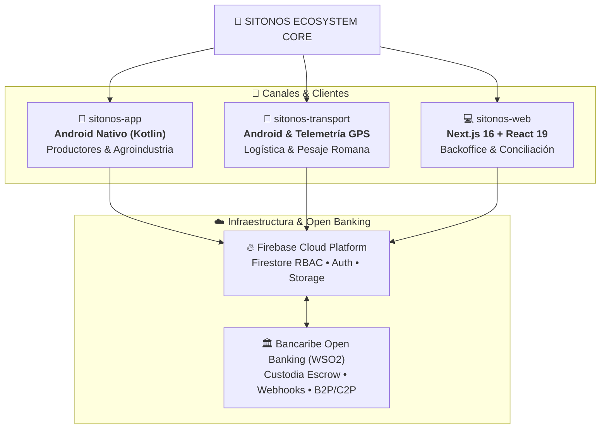

# SITONOS Agro-Industrial Technologies

### 🌾 Conectando el Campo con la Finanza Digital y la Logística Inteligente
*Ganadores del 1.er Lugar — Shark Bank Bancaribe*

---

## 🏢 Sobre SITONOS

**SITONOS** es un ecosistema tecnológico integral diseñado para modernizar y dinamizar el sector agroindustrial en Venezuela y Latinoamérica. Unificamos la comercialización de cosechas a través de contratos digitales protegidos por custodia de fondos (*Escrow*), telemetría satelital GPS para transporte de carga a granel y liquidación bancaria automatizada.

---

## 🏗️ Arquitectura del Ecosistema

---

## 📦 Repositorios Principales

| Repositorio | Descripción | Stack Tecnológico |
| :--- | :--- | :--- |
| **`sitonos-app`** | App Android móvil para productores y compradores de cosechas | Kotlin, Jetpack Compose / XML, Coroutines, Dark Theme |
| **`sitonos-transport`** | Módulo de telemetría y transporte para choferes con GPS y QR | Kotlin, Google Maps Platform, Sensor Telemetry |
| **`sitonos-web`** | Portal web de administración, analítica y conciliación financiera | Next.js 16, React 19, Tailwind CSS, Leaflet |
| **`sitonos-docs`** | Especificaciones de APIs Open Banking (WSO2), arquitectura y seguridad | Markdown, Open Banking Specs |

---

## 🔒 Estándares de Ingeniería & Seguridad

- **Auditoría Continua SAST & OWASP:** Componentes no exportados, cero claves expuestas en código fuente y validación estricta de intents y tokens.
- **Dark Theme Enforced:** Interfaz con diseño visual consistente en `#0A0F1D` / `#121212`.
- **Clean Architecture & SRP:** Separación modular estricta entre vista, lógica de negocio y consumo de APIs bancarias.

---

  © SITONOS Agro-Industrial Technologies. Todos los derechos reservados.

